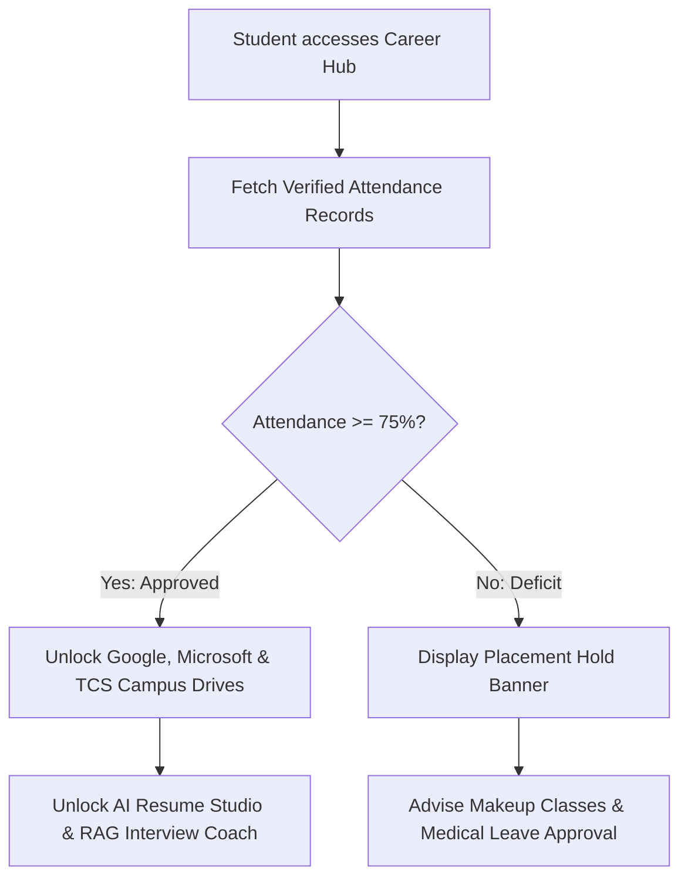

# 🏛️ SmartCampus Ecosystem: Technical Architecture & Topology

## Overview
SmartCampus Ecosystem implements a decentralized, service-oriented architecture designed to operate with zero classroom internet dependency for attendance, paired with advanced cloud-based or local AI engines for student career development.

---

## 1. Network Topology & Port Mapping

| Service Name | Technology | Port | Primary Responsibilities |
| :--- | :--- | :---: | :--- |
| **Attendance Core** | FastAPI / SQLite / PostgreSQL | `8000` | User auth, BLE session lifecycle, attendance records, audit logs. |
| **Career AI Core** | FastAPI / ChromaDB / Gemini | `8001` | PDF parsing, vector search, RAG chatbot, interview prep, eligibility gate. |
| **Unified Web Portal**| React 19 / Vite / Tailwind | `5173` | Unified multi-role portal for Admin, Teacher, Student, and TPO. |
| **Android Student App**| Kotlin / Room / BLE | Native | BLE scanning, local queueing, WorkManager background sync. |
| **Android Teacher App**| Kotlin / Room / GATT | Native | BLE beacon broadcast, embedded GATT server, live roster. |

---

## 2. Attendance & Proximity Verification Pipeline

When a student marks attendance via BLE or offline queue:
1. **Physical RSSI Enforcement:** Signal strength must be $\ge -85\text{ dBm}$. Weaker signals outside the room are rejected.
2. **Session Validity Window:** Session must be in status `ACTIVE` and within the 15-minute lecture start window.
3. **Cryptographic SHA-256 Hash Matching:** The student's incoming token is hashed with SHA-256 and matched against `session_token_hash`. Plaintext tokens are never stored.
4. **Institutional Enrollment Validation:** Verification that the student is registered for the subject, section, and semester.
5. **Composite Key Anti-Duplication:** Enforces unique constraint `(student_id, session_id)` in database.
6. **ACID Transaction Commit:** Inserts into `attendance_records` and writes an immutable entry to `audit_logs`.

---

## 3. Placement Eligibility Gate

The Career AI Service queries the student's attendance records to enforce university placement policies:

